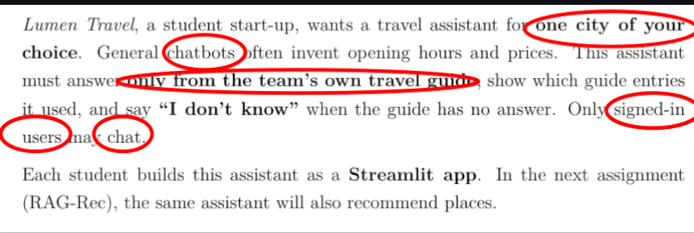
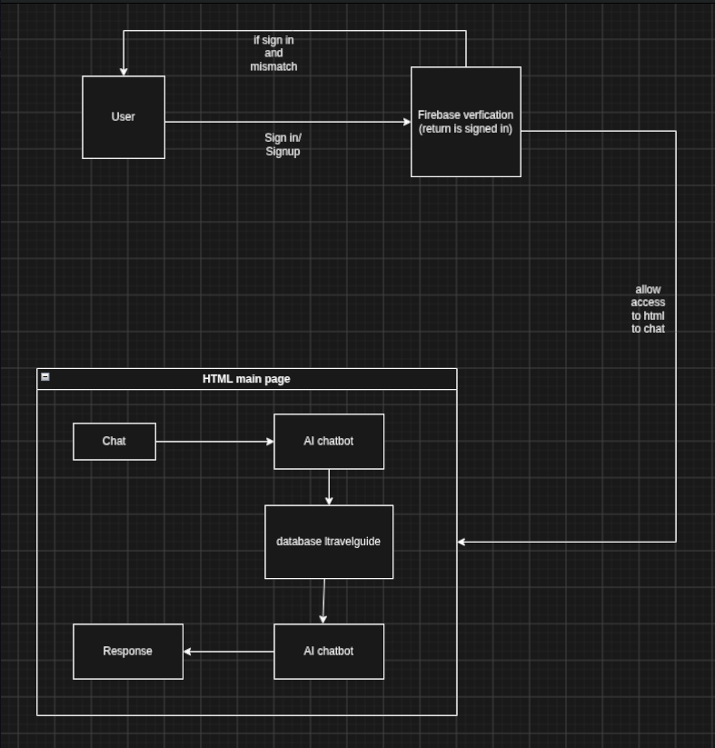
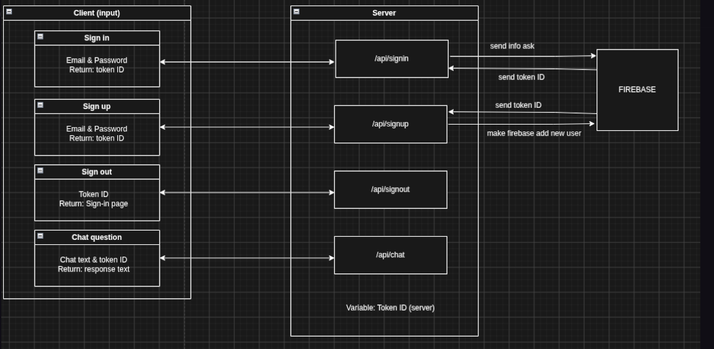

# Lumen Travel Assistant (Ho Chi Minh City) — Sign-in + RAG Chat

Computational Thinking — Practice 03, University of Science (VNU-HCM), Faculty of Information Technology.

## Student information

| Field | Value |
|---|---|
| Name | Vũ Thanh Hải |
| Student ID | 25127323 |
| Class | 25C09 |
| Chosen city | **Ho Chi Minh City** |

## What it does

- Email/password **sign-up, sign-in and sign-out** with Firebase Authentication. The chat page and the `/api/chat` endpoint only work with a valid Firebase ID token.
- A travel guide of 16 short entries in `knowledge_base.json`.
- **RAG chat**: question → `embeddinggemma` embedding → cosine similarity → top-k entries → `qwen3:4b` answers **only** from those entries and cites IDs like `[G03]`.
- A collapsible **Sources** panel under each answer with the retrieved entries and scores.
- **"I don't know"** when nothing in the guide is close enough (no model call) or when the model finds no answer in the context.
- Chat history is kept in server memory per signed-in user and cleared at sign-out. No database.

> Note: the assignment text mentions Streamlit; this version is written in Rust (axum), so it is started with `cargo run` instead of `streamlit run app.py`.

## Project layout

```
Cargo.toml
knowledge_base.json     the travel guide (16 entries)
static/index.html       sign-in form + chat UI
src/main.rs             routes, token check, chat history
src/firebase_client.rs  Firebase sign-up / sign-in (REST)
src/rag.rs              embed, retrieve, build context, generate
.env.example
```

## Install and run

1. Install Rust (https://rustup.rs).
2. In the Firebase console enable **Authentication → Email/Password** and copy the **Web API key** and **Project ID**.
3. Install [Ollama](https://ollama.com) on your own computer and make sure it is running (the desktop app, or `ollama serve`). No Lab 4 server or Pinggy tunnel is needed. On first start the app pulls `embeddinggemma` and `qwen3:4b` automatically if they are missing (a few GB, one time).
4. Create `.env` from the example and fill in the two Firebase values (never commit `.env`):
   ```
   cp .env.example .env
   ```
5. Run:
   ```
   cargo run --release
   ```
6. Open http://localhost:8501.

The guide is embedded **once at start-up**, not per question. After editing `.env` or `knowledge_base.json`, restart the app.

### Settings (`.env`)

| Variable | Default | Meaning |
|---|---|---|
| `OLLAMA_URL` | `http://localhost:11434` | Local Ollama server |
| `FIREBASE_API_KEY` | — | Web API key |
| `FIREBASE_PROJECT_ID` | — | Used to verify ID tokens |
| `TOP_K` | 3 | Entries retrieved per question |
| `MIN_SCORE` | 0.40 | Below this cosine score an entry is not given to the model |

## Error handling

| Situation | Behavior |
|---|---|
| Wrong email/password | "Wrong email or password." |
| Empty email/password or empty question | Message shown, nothing sent |
| Expired token | Back to the sign-in page |
| Ollama unreachable | "The Ollama server is not reachable…" |

## Test table

Run each question in the app, open **Sources**, and fill the last three columns from what you actually see. Tune `MIN_SCORE` if the "not in the guide" questions still get answered or the answerable ones get refused.

| # | Type | Question | Expected ID | Retrieved IDs | Correct? | Failed at |
|---|---|---|---|---|---|---|
| 1 | Answerable | What can I buy at Ben Thanh Market? | G01 | *G01* | *True* | Extraction speed. |
| 2 | Answerable | Which building is famous for a tank crashing through its gates in 1975? | G03 | *G03* | *True* | Extraction speed |
| 3 | Answerable | How far are the Cu Chi Tunnels from the city centre? | G06 | *G06* | *True* | Extraction speed. |
| 4 | Paraphrase | Where can I get jeans, shirts and shoes? | G01 | "I don't know" | *False* | Unable to extract conext and subject. Therefor unable to retrieve ID. |
| 5 | Not in guide | What are the opening hours of the War Remnants Museum? | none | "I don't know" | *True* | Extraction speed. |
| 6 | Not in guide | How much does a Grab to the airport cost? | none | "I don't know" | *True* | None |

## Computational Thinking

### Abstraction




### Decomposition & Pattern Recognition

| # | Step (Decomposition) | Input → Output | Where in the project | Pattern (Recognition) |
|---|---|---|---|---|
| 1 | Sign in | email + password → Firebase ID token | `src/firebase_client.rs` | Same email/password flow as **Lab 3** |
| 2 | Check token | token → signed-in user, or 401 | `authenticate()` in `src/main.rs` | Same **Lab 3** token check, now on every protected route |
| 3 | Embed | question text → vector | `embed()` in `src/rag.rs` | Same Ollama embedding call as **Lab 4**, also used to embed the guide at startup |
| 4 | Retrieve | vector → top-k entries with scores | `retrieve()` in `src/rag.rs` | Repeating **filter → score → top-k** pattern, reusable with a category filter in RAG-Rec |
| 5 | Build context | relevant entries → text block `[id] title + text` | `answer()` in `src/rag.rs` | Same context format for every question: `[id]` plus text |
| 6 | Generate | context + question → cited answer or "I don't know" | `answer()` in `src/rag.rs` | Same Ollama chat call as **Lab 4**, with a fixed rule: answer only from the context |
| 7 | Display | answer + hits → chat bubble + Sources panel | `static/index.html` | Same message pattern for user and assistant, with an expandable Sources list |

## AI tools used

Claude was used to generate the first version of the Rust code
Prompt: publish the file and ask to create a rust code using specific crates only.
(I didn't save the claude version code because I forgot)

## Demonstration video

